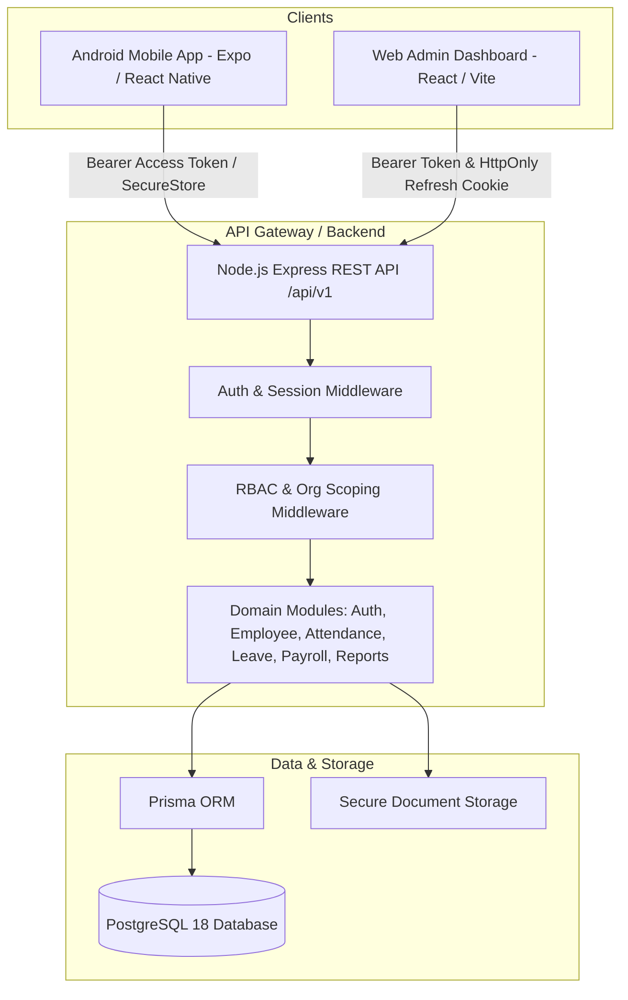

# VRPI HRMS - System Architecture

## 1. System Overview
VRPI HRMS is a modern, modular human resource management platform designed for enterprise reliability, high auditability, and mobile workforce support. The system comprises an Android mobile client for employees, a web administration dashboard for HR managers and administrators, and an Express.js REST API backed by PostgreSQL.

---

## 2. Pinned Technology Stack & Version Matrix

| Layer | Technology | Pinned Version / Range | Rationale |
| :--- | :--- | :--- | :--- |
| **Runtime** | Node.js (LTS) | `^20.x` or `^24.x` (Observed: `v24.14.0`) | Modern LTS JS runtime with stable native fetch and ESM/CJS compatibility |
| **Package Manager**| npm | `^10.x` / `^11.x` (Observed: `11.9.0`) | Built-in workspace support with low overhead |
| **Database** | PostgreSQL | `18.3` (Local service running) | Robust ACID guarantees, partial indexes, and exclusion constraint capabilities |
| **ORM** | Prisma | `^6.5.0` | Strongly typed schema, automatic migrations, type safety across API layers |
| **Backend API** | Express | `^4.21.0` | Lightweight, un-opinionated, ultra-fast cold start, minimal memory footprint |
| **Password Hashing**| bcryptjs / argon2 | `bcryptjs ^2.4.3` | High security credential hashing without native compilation issues on Windows |
| **Validation** | Zod | `^3.24.0` | Universal schema validation shared across API, Web, and Mobile |
| **Mobile App** | Expo SDK / React Native | `Expo ~52.0.0` / `RN ~0.76.0` | Stable cross-platform mobile engine, Expo Router, EAS Build APK integration |
| **Mobile Navigation**| Expo Router | `^4.0.0` | File-based navigation, deep linking, native performance |
| **Mobile State** | Zustand | `^5.0.0` | Minimal boilerplate, memory-efficient state management |
| **Web Dashboard** | React + Vite | `React ^18.3.0` / `Vite ^6.0.0` | Ultra-fast HMR, sub-second development reload, lean bundle footprint |
| **Web Styling** | Tailwind CSS + Lucide | `Tailwind ^3.4.0` | Zero-runtime CSS design token system, accessible styling |
| **Data Fetching** | TanStack Query | `^5.60.0` | Declarative caching, background polling, stale-while-revalidate |

---

## 3. Authentication & Session Architecture

### 3.1 Token Strategy
1. **Access Tokens**: Short-lived JSON Web Tokens (15 minutes). Signed with `JWT_ACCESS_SECRET`. Encodes `userId`, `employeeId`, `organizationId`, and `role`.
2. **Refresh Tokens**: Cryptographically random 256-bit entropy tokens stored hashed in the `Session` table. Lifetime: 7 days.
3. **Session Rotation & Reuse Detection**:
   - Every refresh request generates a new refresh token and invalidates the previous one (token family rotation).
   - If an invalidated refresh token is presented again (indicating token compromise or replay attack), the backend immediately revokes the **entire token family** for that user and logs a security event.

### 3.2 Platform-Specific Token Handling
- **Web Dashboard**: Refresh tokens are transported via `HttpOnly`, `SameSite=Lax`, `Secure` cookies. Access tokens are kept in JavaScript memory only. State-changing requests enforce CSRF defense via custom application headers (`X-Requested-With`).
- **Mobile Android App**: Refresh tokens are stored in hardware-backed `Expo SecureStore` and transmitted in request payloads to `/api/v1/auth/mobile/refresh`. Cookies are not used on native clients.

---

## 4. Role-Based Access Control (RBAC) & Permission Matrix

VRPI HRMS enforces a strict least-privilege matrix across four primary roles:
1. `SUPER_ADMIN`: Complete system and organization administration.
2. `HR_ADMIN`: Full workforce management, attendance/leave approvals, and payroll administration.
3. `HR`: Day-to-day employee operations, leave review, attendance monitoring. (Restricted from salary data).
4. `EMPLOYEE`: Self-service portal (own profile, own attendance, own leave applications, own payslips).

### Resource Action Matrix

| Resource | Action | Super Admin | HR Admin | HR | Employee |
| :--- | :--- | :---: | :---: | :---: | :---: |
| **Organization** | View / Update Settings | ✅ | ❌ | ❌ | ❌ |
| **Employee Directory** | List / Search | ✅ | ✅ | ✅ | Limited (Colleagues) |
| **Employee Profile** | Create / Edit / Deactivate | ✅ | ✅ | Limited (Fields) | ❌ |
| **Employee Profile** | View Own | ✅ | ✅ | ✅ | ✅ |
| **Attendance** | Check-in / Check-out (Self)| ✅ | ✅ | ✅ | ✅ |
| **Attendance** | View Org-wide Logs | ✅ | ✅ | ✅ | ❌ |
| **Attendance** | Manual Correction / Override | ✅ | ✅ | ❌ | ❌ (Request only) |
| **Leave Policies** | Configure Types & Accruals | ✅ | ✅ | ❌ | ❌ |
| **Leave Requests** | Apply for Leave (Self) | ✅ | ✅ | ✅ | ✅ |
| **Leave Requests** | Approve / Reject | ✅ | ✅ | ✅ (Assigned) | ✅ (Direct Reports only) |
| **Salary Records** | Manage / View All | ✅ | ✅ | ❌ | ❌ |
| **Salary Records** | View Own Payslips | ✅ | ✅ | ❌ | ✅ |
| **Audit Logs** | Read System Audit Trails | ✅ | ✅ | ❌ | ❌ |

---

## 5. Multi-Tenancy & Data Isolation

All business entities belong to an `organizationId`. 
- **Query Scoping**: Every database lookup must mandate `where: { organizationId: req.user.organizationId }`.
- **IDOR Protection**: Accessing an employee or leave record validates both `organizationId` match and personal ownership checks (unless possessing elevated HR/Admin permissions).
- **Timezone Normalization**:
  - All database timestamps are persisted strictly in **UTC (`TIMESTAMPTZ`)**.
  - Attendance date boundaries (midnight-to-midnight) and late marks are computed in the organization's configured IANA timezone (default: `Asia/Kolkata`).
