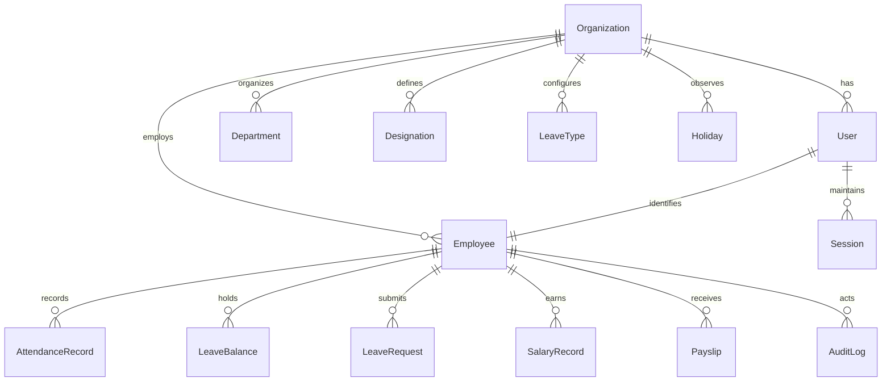

# VRPI HRMS - Database Schema Specification

## 1. Engine & Design Principles
- **RDBMS**: PostgreSQL 18.x
- **ORM**: Prisma ORM with raw SQL migration extensions for complex constraints.
- **Tenancy**: Multi-tenant via `organizationId` foreign key on all core business tables.
- **Timestamps**: All temporal fields stored in UTC (`TIMESTAMPTZ`).
- **Monetary Values**: Stored as `Decimal(12, 2)` with currency code (`INR` default).

---

## 2. Entity Relationship Overview

---

## 3. Core Tables & Key Constraints

### 3.1 Organization & Security
- **Organization**: `id`, `name`, `code` (unique), `timezone` (default: 'Asia/Kolkata'), `currency` (default: 'INR'), `createdAt`, `updatedAt`.
- **User**: `id`, `organizationId`, `email` (unique within org), `passwordHash`, `role` (`SUPER_ADMIN`, `HR_ADMIN`, `HR`, `EMPLOYEE`), `isActive`, `createdAt`, `updatedAt`.
- **Session**: `id`, `userId`, `refreshTokenHash`, `familyId`, `isRevoked`, `deviceInfo`, `expiresAt`, `createdAt`.

### 3.2 Employee Directory
- **Department**: `id`, `organizationId`, `name`, `code`, `createdAt`.
- **Designation**: `id`, `organizationId`, `title`, `departmentId`, `createdAt`.
- **Employee**:
  - `id`, `organizationId`, `userId` (unique nullable), `employeeCode` (unique per org), `firstName`, `lastName`, `email`, `phone`, `avatarUrl`, `joiningDate`, `departmentId`, `designationId`, `managerId` (self-referencing), `isActive`, `createdAt`, `updatedAt`.

### 3.3 Attendance & Shifts
- **AttendanceRecord**:
  - `id`, `organizationId`, `employeeId`, `date` (`DATE`), `checkInTime` (`TIMESTAMPTZ`), `checkOutTime` (`TIMESTAMPTZ`), `totalMinutes`, `status` (`PRESENT`, `ABSENT`, `HALF_DAY`, `LATE`, `ON_LEAVE`), `checkInSource` (`MOBILE`, `WEB`), `idempotencyKey` (unique), `notes`, `createdAt`, `updatedAt`.
  - **Constraint**: Partial unique index ensuring at most one active (open) punch per employee per calendar day.

### 3.4 Leave Management
- **LeaveType**: `id`, `organizationId`, `name` (e.g., Casual, Sick, Earned), `code`, `daysPerYear`, `requiresApproval`, `isActive`.
- **LeaveBalance**: `id`, `organizationId`, `employeeId`, `leaveTypeId`, `year`, `allocatedDays`, `usedDays`, `pendingDays`, `remainingDays`.
- **LeaveRequest**:
  - `id`, `organizationId`, `employeeId`, `leaveTypeId`, `startDate` (`DATE`), `endDate` (`DATE`), `isHalfDay`, `totalDays`, `reason`, `status` (`PENDING`, `APPROVED`, `REJECTED`, `CANCELLED`), `reviewedById`, `reviewComment`, `reviewedAt`, `createdAt`, `updatedAt`.
  - **Constraint**: PostgreSQL Exclusion constraint (`EXCLUDE USING gist`) preventing overlapping dates for approved/pending leaves per employee.

### 3.5 Payroll & Sensitive Storage
- **SalaryRecord**: `id`, `organizationId`, `employeeId`, `effectiveFrom`, `baseSalary` (`Decimal`), `allowances` (`Decimal`), `deductions` (`Decimal`), `currency`, `createdAt`.
- **Payslip**: `id`, `organizationId`, `employeeId`, `month`, `year`, `grossPay`, `netPay`, `pdfStorageKey`, `status` (`DRAFT`, `PUBLISHED`), `publishedAt`.

### 3.6 Audit & Idempotency
- **AuditLog**: `id`, `organizationId`, `actorId`, `actorEmail`, `action`, `resource`, `resourceId`, `diff`, `ipAddress`, `userAgent`, `createdAt`.
- **IdempotencyKey**: `key`, `organizationId`, `userId`, `endpoint`, `responseCode`, `responseBody`, `expiresAt`.
